# System Architecture

This diagram describes the current local development setup and the batch API. Document inference always runs on the local machine. Optional Workers KV and R2/S3 transfers require network access, while batch inference remains CPU-only and processes one file at a time.

```mermaid
flowchart LR
    User([User or API client])

    subgraph Browser[Browser]
        UI[React interface<br/>upload, queue, preview, results]
        Preview[PDF.js preview<br/>Mammoth + DOMPurify for DOCX]
        UI --> Preview
    end

    subgraph Local[Local computer]
        Vite[Vite dev server<br/>127.0.0.1:5174<br/>serves React and proxies /api]
        API[FastAPI + Uvicorn<br/>127.0.0.1:8002<br/>health, single-file, batch routes]

        subgraph Batch[Batch API]
            Upload[POST /api/batches<br/>multipart files]
            Folder[POST /api/batches/folder<br/>configured local inbox]
            KVStore[POST /api/batches/kv/store-folder<br/>store local inbox in private Workers KV]
            KVUpload[POST /api/batches/kv/upload-folder<br/>store inbox in private Workers KV, then process]
            KVIn[POST /api/batches/kv<br/>import private Workers KV inbox]
            S3In[Optional POST /api/batches/s3<br/>import configured S3 prefix]
            R2In[Optional POST /api/batches/r2<br/>import private R2 inbox]
            R2Upload[Optional POST /api/batches/r2/upload-folder<br/>store inbox in private R2, then process]
            Queue[One background worker<br/>processes one file at a time]
            State[SQLite job/file status]
            Store[Local job storage<br/>temporary inputs + masked PDFs]
            Status[GET status and download routes]
            Upload --> Queue
            Folder --> Queue
            KVUpload --> Queue
            KVIn --> Queue
            S3In --> Queue
            R2In --> Queue
            R2Upload --> Queue
            Queue <--> State
            Queue --> Store
            State --> Status
            Store --> Status
        end

        subgraph Pipeline[Shared local document pipeline]
            Check[Validate type, size, and page limits]
            Decode[Decode pages<br/>Pillow, pypdfium2, LibreOffice]
            DocYOLO[YOLO Aadhaar document segmentation]
            OpenCV[OpenCV boundary proposals]
            Reconcile[Reconcile identity and boundary]
            Correct[Perspective, quality, orientation]
            OCR[PaddleOCR text and word positions]
            NumberYOLO[YOLO Aadhaar-number detector]
            Verify[Context, 12 digits, first-digit rule,<br/>confidence and Verhoeff]
            Locate[Locate per-digit boxes]
            Mask[Pixel-mask digits 1-8]
            Audit[Post-mask OCR safety audit]
            PDF[Flattened masked PDF]
            Reject[Reject; no masked PDF]

            Check --> Decode
            Decode --> DocYOLO
            Decode --> OpenCV
            DocYOLO --> Reconcile
            OpenCV --> Reconcile
            Reconcile --> Correct
            Correct --> OCR
            Correct --> NumberYOLO
            OCR --> Verify
            NumberYOLO --> Verify
            Verify -->|Accepted| Locate --> Mask --> Audit
            Verify -->|Uncertain| Reject
            Audit -->|Safe| PDF
            Audit -->|Complete number remains| Reject
        end

        Weights[Local model weights<br/>backend/models/*.pt]
        Weights --> DocYOLO
        Weights --> NumberYOLO
        API --> Upload
        API --> Folder
        API --> KVUpload
        API --> KVIn
        API --> S3In
        API --> R2In
        API --> R2Upload
        API --> Status
        API --> Check
        Queue --> Check
        PDF --> Store
        Reject --> State
        Vite -->|serves app| UI
        UI -->|/api requests| Vite
        Vite -->|development proxy| API
    end

    subgraph Optional[Optional Cloudflare storage]
        KVSource[Workers KV inbox prefix]
        KVOutput[Workers KV masked-output prefix]
        S3Source[Configured R2 inbox prefix]
        S3Output[Configured R2 upload and masked-output prefixes]
    end

    User --> UI
    User --> API
    KVIn -->|reads stored originals| KVSource
    KVUpload -->|copies local inbox originals| KVSource
    Queue -->|stores masked copies for KV batches| KVOutput
    R2In -->|reads stored originals| S3Source
    R2Upload -->|copies local inbox originals| S3Output
    Store -->|copies masked results when configured| S3Output
```

## What happens in a batch

1. Submit PDFs/images through `POST /api/batches`, process the configured local inbox with `POST /api/batches/folder`, or configure Workers KV. Use `POST /api/batches/kv/store-folder` to store inbox files without masking, then `POST /api/batches/kv` with its returned relative prefix to start processing; `POST /api/batches/kv/upload-folder` remains a one-call store-and-process option.
2. The API creates a persistent batch ID and stores queued file status in SQLite.
3. A single background worker processes each file using the same Aadhaar pipeline as `POST /api/process`. YOLO is set to CPU, PaddleOCR is set to CPU, and CPU library threads are capped at four.
4. Each source is checked and decoded, Aadhaar is detected and verified, digits 1–8 are masked, and post-mask OCR checks that no full Aadhaar number remains.
5. A safe result is saved as a flattened PDF. Uncertain or unsafe inputs are reported as rejected and do not get a masked PDF.
6. Use `GET /api/batches/{batch_id}` to check progress and obtain download links. Download individual PDFs or all successful PDFs plus a JSON manifest. Workers KV stores originals and masked copies for KV batches; R2/S3 remains optional.

## Storage and network behavior

- **Direct upload:** the API stages an input copy while it is queued/processing, then removes it. The original on the caller's computer is not changed.
- **Local folder:** the API only reads below `AADHAAR_BATCH_INPUT_ROOT`, stages a copy, and leaves the original file in the inbox.
- **Workers KV input:** the API reads only below the configured KV inbox prefix. Uploading a local inbox copies originals to the KV prefix and processes local staged copies. Originals remain in KV until manually deleted. These actions need network access.
- **Masked output:** by default PDFs, batch status, and the manifest are kept under the local batch storage root for 24 hours. Set `AADHAAR_BATCH_STORAGE_ROOT` to choose a location. KV-batch masked copies are written under a separate KV output prefix and follow the batch retention period. Optional R2/S3 output remains supported.
- **Local API address:** `http://127.0.0.1:8002/docs` is the interactive API page for the local development server. It is not a public hosted link.
- **Optional summary:** `POST /api/card-summary` can use Azure OpenAI if configured. Batch processing does not call that service.

For setup commands, limits, request examples, and manual preparation, see [README.md](README.md#cpu-only-batch-api). The detailed recognition and masking sequence is in [SYSTEM_DIAGRAM.md](SYSTEM_DIAGRAM.md).
